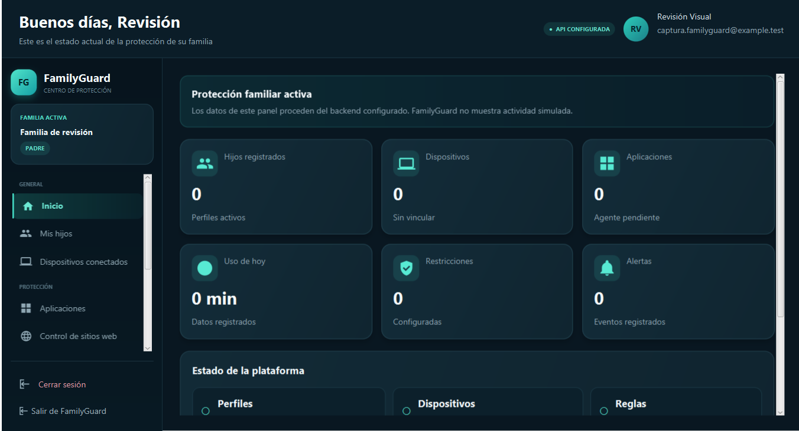
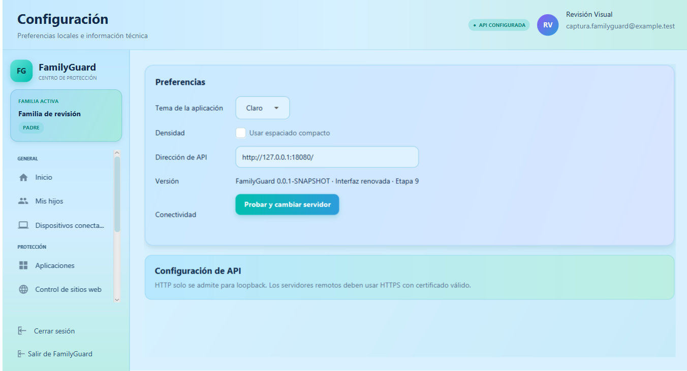
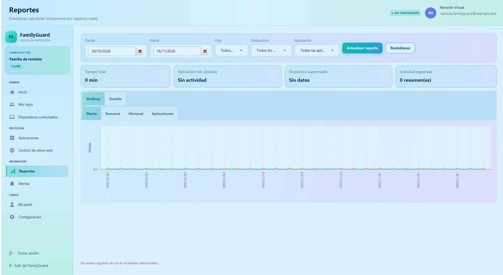

<div align="center">

# 🛡️ FAMILYGUARD

### 👨‍👩‍👧‍👦 Protección digital familiar · 💻 Control parental para Windows

**Supervisa el uso de computadoras, administra reglas y consulta la actividad desde una aplicación de escritorio.**


**📌 Proyecto en desarrollo** · **🧩 3 módulos Maven** · **🌿 Rama `escritorio`**

[✨ Funciones](#-funcionalidades-principales) · [🖼️ Capturas](#️-capturas-del-proyecto) · [🚀 Instalación](#-instalación-para-desarrolladores) · [▶️ Ejecución](#️-cómo-ejecutar-el-sistema) · [🗺️ Avances](PROGRESO.md)

</div>

---

## 🌟 ¿Qué es FamilyGuard?

**FamilyGuard** es un sistema de **control parental para Windows**, diseñado para apoyar la supervisión responsable de computadoras utilizadas por menores. Integra un panel de administración **JavaFX**, una **API backend Spring Boot** y un **agente Windows** para registrar actividad y aplicar determinadas reglas de uso.

> 🧭 **Importante:** Este repositorio contiene código fuente para desarrollo. Las funciones de bloqueo, la supervisión remota y los instaladores deben validarse en el entorno donde se utilicen; no todas las características están garantizadas para todos los equipos.

## ✨ Funcionalidades principales

| | Módulo | ¿Qué permite hacer? |
|:--:|---|---|
| 👤 | **Cuentas y acceso** | Registro, inicio de sesión, perfiles y cambio de contraseña. |
| 👨‍👩‍👧 | **Gestión familiar** | Administración de menores y vinculación de dispositivos. |
| 🖥️ | **Detección de actividad** | Identificación de aplicaciones, procesos y ventanas activas mediante el agente. |
| ⏱️ | **Tiempo de uso** | Registro y seguimiento de actividad para consultas y reportes. |
| 🚫 | **Restricciones de aplicaciones** | Reglas, horarios y límites; efectividad sujeta a permisos de Windows. |
| 🌐 | **Control web** | Componentes para reglas de sitios y eventos web; cobertura dependiente del método de filtrado. |
| 📊 | **Dashboard** | Consultas de dispositivos, actividad y otros indicadores disponibles. |
| 🎨 | **Interfaz moderna** | Navegación, tablas paginadas, temas claro y oscuro. |
| 🔗 | **Comunicación remota** | Componentes de vinculación y sincronización; requieren configuración y pruebas. |

## 🖼️ Capturas del proyecto

<div align="center">

**🌙 Panel de administración — tema oscuro**



**☀️ Configuración — tema claro**



**📈 Reportes**



</div>

> 📸 Las imágenes corresponden a capturas incluidas en `docs/captures/`.

## 🏗️ Arquitectura de FamilyGuard

```text
👨‍👩‍👧‍👦 Padre / tutor
         │
         ▼
🖥️ FamilyGuard Admin (JavaFX)
         │  API REST
         ▼
⚙️ FamilyGuard Backend (Spring Boot)
         │                         ▲
         ▼                         │ API / sincronización
🗄️ MySQL (familyguard_db)           │
                             🛡️ FamilyGuard Agent
                                (Windows del menor)
```

| Componente | Carpeta | Responsabilidad |
|---|---|---|
| 🖥️ **Admin** | `familyguard-admin/` | Interfaz gráfica para el responsable. |
| 🛡️ **Agent** | `familyguard-agent/` | Detección local, seguimiento y ejecución de restricciones compatibles. |
| ⚙️ **Backend** | `familyguard-backend/` | API REST, autenticación, datos y reglas de negocio. |

## 🧰 Tecnologías

**☕ Desarrollo:** Java 17 · JavaFX · Maven Wrapper  
**⚙️ Servidor:** Spring Boot 4.1.2 · Spring Security · Spring Data JPA · Hibernate  
**🗃️ Persistencia:** MySQL 8.4.3 · Flyway (migraciones V1–V7)  
**🪟 Sistema:** Windows · PowerShell · scripts de instalación

## 📋 Requisitos previos

| Herramienta | Requisito |
|---|---|
| 💻 **Sistema operativo** | Windows, para ejecutar los componentes de escritorio y agente. |
| ☕ **JDK** | Java 17, configurado en `PATH` o `JAVA_HOME`. |
| 🗄️ **MySQL** | Instancia en ejecución; en desarrollo se usa Laragon y MySQL local. |
| 🌐 **Git** | Para clonar el repositorio. |
| 📦 **Maven** | Se incluye `mvnw.cmd` (Maven Wrapper). |
| 🧰 **Opcional** | IDE Java y herramientas de empaquetado para generar instaladores. |

## 🚀 Instalación para desarrolladores

### 📥 1. Obtener el proyecto

En **CMD** o **PowerShell**:

```cmd
git clone -b escritorio https://github.com/Reyder-villafuerte/DevSync.git
cd DevSync
```

> 🔐 Si el repositorio es privado, debes iniciar sesión en GitHub con una cuenta autorizada.

### ✅ 2. Verificar Java

```cmd
java -version
mvnw.cmd -version
```

### 🗄️ 3. Preparar la base de datos

En el **entorno local actual**, el backend utiliza:

```properties
spring.datasource.url=jdbc:mysql://127.0.0.1:3306/familyguard_db
spring.datasource.username=root
spring.datasource.password=
spring.datasource.driver-class-name=com.mysql.cj.jdbc.Driver
```

⚠️ **Esta configuración corresponde únicamente al desarrollo local. No debe utilizarse en producción. No modificarla sin autorización del responsable del proyecto.**

Si la base de datos aún no existe, puedes crearla en MySQL:

```sql
CREATE DATABASE IF NOT EXISTS familyguard_db
  CHARACTER SET utf8mb4
  COLLATE utf8mb4_unicode_ci;
```

**Si ya existe, no la borres ni recrees.** El esquema se administra mediante migraciones Flyway.

### 🔨 4. Compilar

Desde la carpeta raíz:

```cmd
mvnw.cmd clean package
```

> Algunas pruebas de integración pueden requerir MySQL activo, permisos específicos o un entorno Windows preparado.

## ▶️ Cómo ejecutar el sistema

### ⚙️ Backend

1. Inicia **MySQL** en Laragon.
2. En CMD, desde la raíz del repositorio, ejecuta:

```cmd
mvnw.cmd -pl familyguard-backend spring-boot:run
```

3. Comprueba el endpoint de salud, si el backend arrancó correctamente:

```text
http://localhost:8080/actuator/health
```

### 🖥️ Administrador JavaFX

El módulo está en `familyguard-admin/`. Ábrelo en tu IDE y ejecuta su clase de arranque configurada. Si el `pom.xml` tiene el plugin JavaFX habilitado, prueba:

```cmd
mvnw.cmd -pl familyguard-admin javafx:run
```

### 🛡️ Agente Windows

El módulo se encuentra en `familyguard-agent/`. Antes de ejecutarlo, configura la conexión con el backend y revisa los requisitos de permisos de Windows.

📖 **Guía técnica:** [docs/AGENTE_WINDOWS.md](docs/AGENTE_WINDOWS.md)

> La manera exacta de arrancar y empaquetar cada módulo depende de su `pom.xml` y de los scripts del repositorio. Comprueba las instrucciones técnicas antes de distribuirlo.

## 🧪 Pruebas y calidad

```cmd
mvnw.cmd test
```

El repositorio incluye pruebas para **autenticación, APIs, persistencia, reglas del agente, detección de actividad, navegación y temas visuales**. La existencia de una prueba no implica que haya superado la última ejecución en todos los entornos.

## 🗂️ Estructura del repositorio

```text
📁 FamilyGuard / DevSync (rama escritorio)
├── 🖥️ familyguard-admin/        # Aplicación JavaFX
├── 🛡️ familyguard-agent/        # Agente de Windows
├── ⚙️ familyguard-backend/      # API y lógica de negocio
│   └── src/main/resources/
│       ├── application.properties
│       ├── application-remote.properties
│       └── db/migration/        # Flyway V1 a V7
├── 📚 docs/                     # Guías y capturas
├── 🖼️ img/                      # Recursos gráficos
├── 🔧 config/                   # Ejemplos de configuración
├── 📜 scripts/
│   ├── backend/                 # Scripts del backend
│   └── installer/               # Construcción de instaladores
├── 📦 pom.xml                   # Maven multimódulo
├── 🚀 mvnw.cmd                  # Maven Wrapper para Windows
├── 📘 PROGRESO.md               # Estado verificable
└── 📝 README.md
```

## 📦 Instalador para Windows

El repositorio dispone de herramientas de empaquetado en `scripts/installer/`:

- 📘 [Instrucciones del instalador](scripts/installer/README.md)
- 🛠️ `scripts/installer/build-installers.ps1`

**Un script de instalación no equivale a una versión pública instalada y probada.** Sigue la documentación correspondiente y valida el resultado antes de usarlo en equipos reales.

## 🔐 Privacidad y seguridad

- ✅ Utilizar únicamente con autorización sobre los dispositivos administrados.
- 🔑 Mantener tokens, contraseñas y archivos `.env` reales fuera de Git.
- 🔒 Usar conexiones seguras para comunicaciones por internet.
- 👁️ Informar de forma transparente qué actividad se recopila y por qué.
- 🧪 Probar cuidadosamente las restricciones de procesos y sitios para evitar interrupciones indebidas.
- 💾 Realizar copias de seguridad antes de cambios de base de datos.

## 🗺️ Estado y próximos pasos

📍 **Estado:** desarrollo y pruebas continuas. Consulta [PROGRESO.md](PROGRESO.md) para ver qué está implementado y qué ha sido verificado.

**Posibles mejoras:** 📈 reportes más completos · 🔔 avisos configurables · 🔄 mayor robustez de sincronización · 📦 instaladores validados · 🧪 más pruebas de Windows · 🛡️ refuerzo de privacidad.

## 📚 Documentación técnica

| Guía | Contenido |
|---|---|
| 📘 [PROGRESO.md](PROGRESO.md) | Avances y estado verificable. |
| 🛡️ [AGENTE_WINDOWS.md](docs/AGENTE_WINDOWS.md) | Configuración y funcionamiento del agente. |
| 🔗 [CONEXION_REMOTA.md](docs/CONEXION_REMOTA.md) | Comunicación y conexión remota. |
| 📊 [DASHBOARD_JAVAFX.md](docs/DASHBOARD_JAVAFX.md) | Interfaz de administración. |
| 🗄️ [MODELO_DATOS.md](docs/MODELO_DATOS.md) | Modelo de persistencia. |
| 📦 [Instalador](scripts/installer/README.md) | Empaquetado para Windows. |

---

<div align="center">

### 🛡️ FamilyGuard

**💙 Tecnología para una experiencia digital familiar más segura y responsable.**

📂 [Repositorio DevSync](https://github.com/Reyder-villafuerte/DevSync) · 🌿 Rama `escritorio`

<sub>⚠️ Proyecto en desarrollo. La licencia de uso y distribución debe definirse por sus responsables.</sub>

</div>

